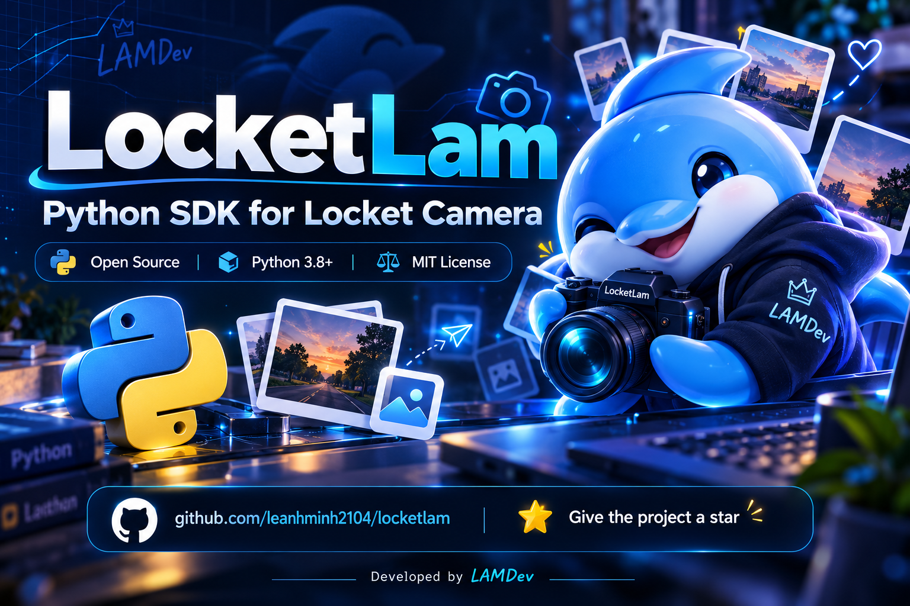
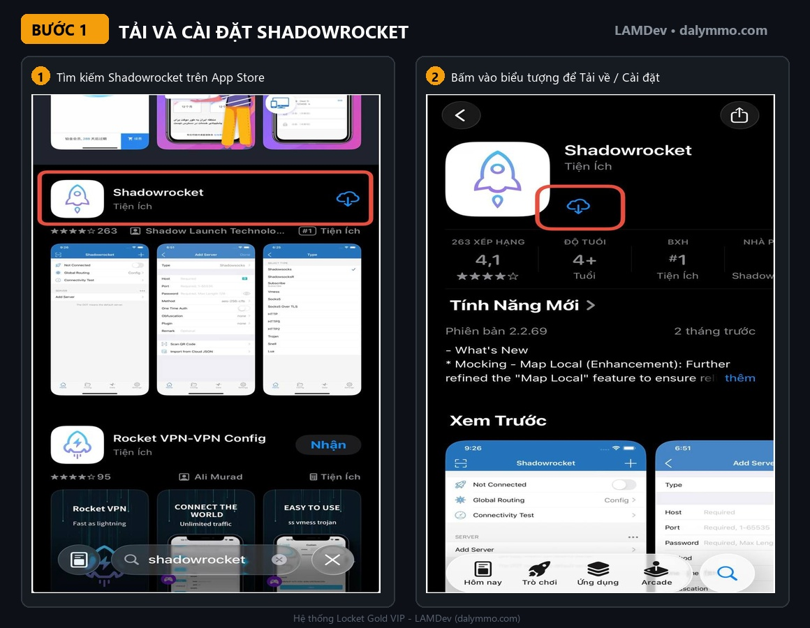
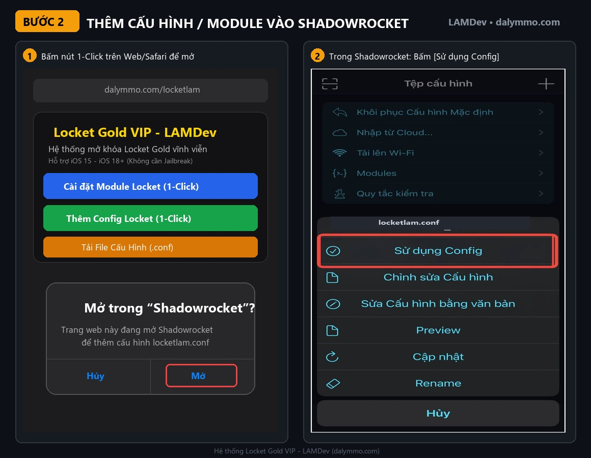
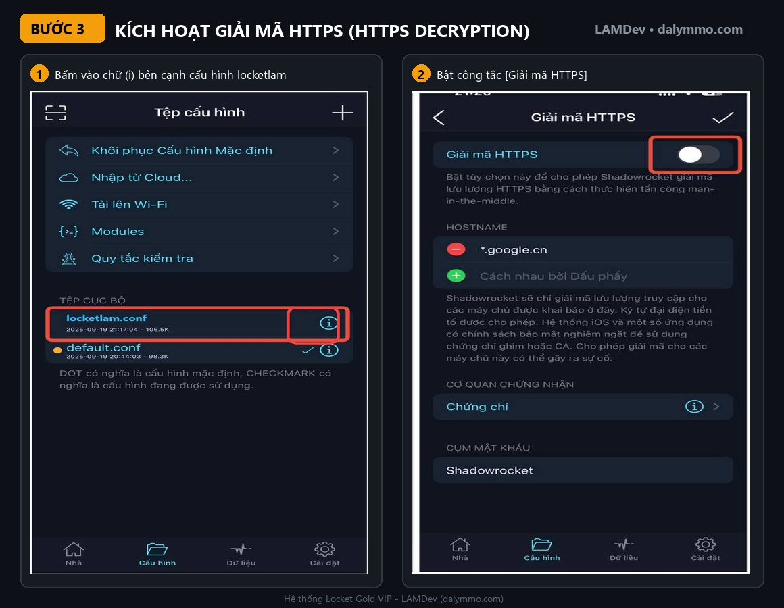
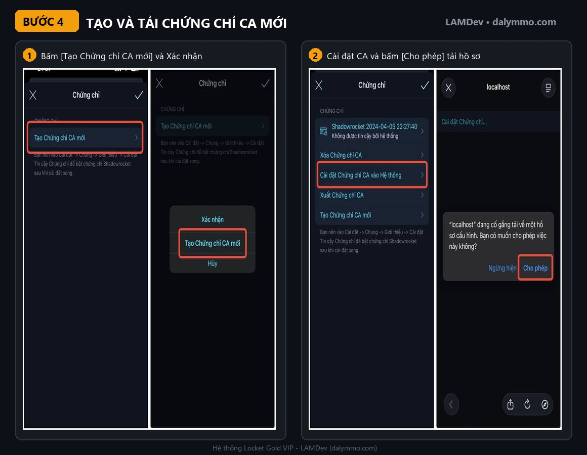
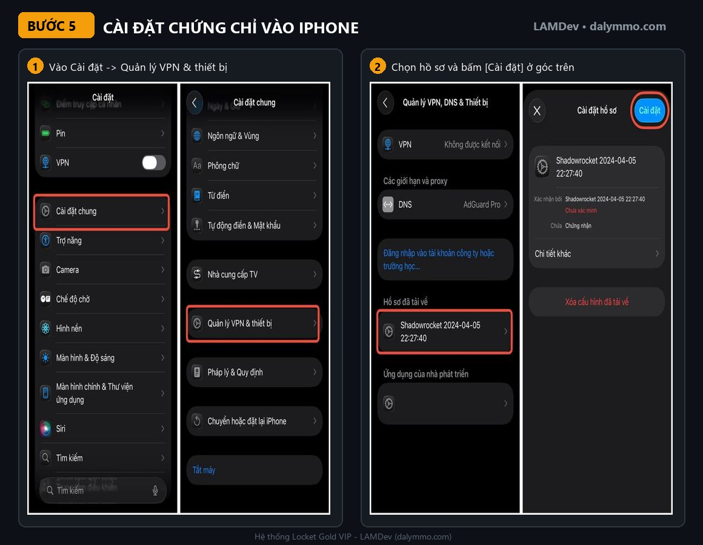
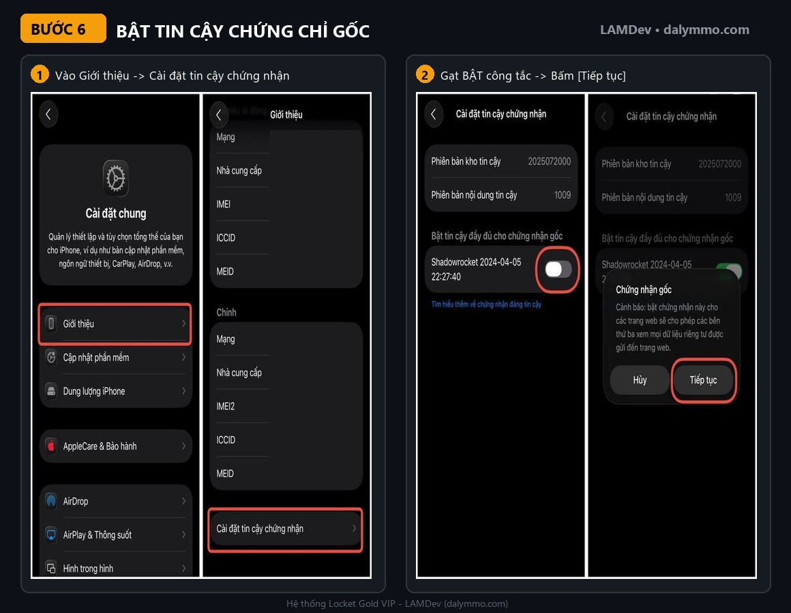
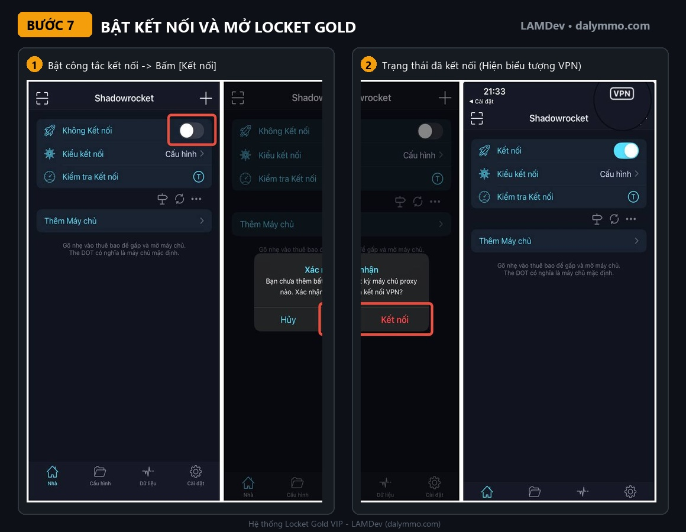

  

# 💛 Locket Gold VIP - LAMDev

> **Bộ công cụ chuyên biệt mở khóa Locket Gold VIP vĩnh viễn & Chống thu hồi**  
> 🌐 Website: [dalymmo.com](https://dalymmo.com) | 📢 Kênh hỗ trợ: [Telegram @dalymmo](https://t.me/dalymmo)  
> 📦 Repository: [leanhminh2104/locketlam](https://github.com/leanhminh2104/locketlam/tree/shadowrocket) | 🌿 Nhánh: `shadowrocket`

---

## 🌟 Giới thiệu

**LocketLAM** là bộ giải pháp mở khóa Locket Gold chuyên nghiệp do **LAMDev** phát triển, tinh gọn **100% dành riêng cho ứng dụng Locket**, loại bỏ toàn bộ các thành phần dư thừa của các ứng dụng khác giúp hệ thống hoạt động nhẹ nhất, mượt nhất và ổn định nhất.

Mọi tính năng VIP của Locket Gold đều được mở khóa toàn diện từ giao diện, camera, dung lượng bộ nhớ cho tới các quyền hạn cao cấp trên hệ thống. Kèm theo đó là giải pháp **DNS Chống thu hồi độc quyền từ DalyMMO** giúp bạn giữ trạng thái Gold vĩnh viễn mà không cần phải bật VPN liên tục.

---

## ✨ Danh sách tính năng mở khóa (Full Features)

| Nhóm tính năng | Chi tiết tính năng mở khóa |
| :--- | :--- |
| **Gói VIP** | Mở khóa gói đăng ký **Locket Gold VIP 1 năm** (Gia hạn tự động vĩnh viễn đến năm 9999). |
| **Hồ sơ & Huy hiệu** | Huy hiệu vàng **Gold Badge** hiển thị trên trang cá nhân và bài đăng. |
| **Giao diện & Icon** | Toàn quyền chọn tất cả **App Icon** độc quyền và **Chủ đề máy ảnh (Camera Themes)**. |
| **Đăng tải & Camera** | Tải ảnh trực tiếp từ **Album/Thư viện (Camera Roll)** không giới hạn, quay video dài hơn. |
| **Tương tác & Xem** | Mở khóa tính năng **Locket Views** (Biết chính xác ai đã xem bài đăng Locket của bạn). |
| **Chú thích & Bạn bè** | Viết **chú thích dài (Long Captions)** không bị giới hạn ký tự; kết bạn không giới hạn số lượng. |
| **Tiện ích (Widgets)** | Toàn quyền sử dụng tất cả **Khung viền Widget (Custom Widget Frames)** cao cấp. |
| **Chuỗi bạn bè** | Tự động kích hoạt tính năng **Khôi phục chuỗi (Streak Recovery)** khi lỡ quên gửi locket. |
| **Trải nghiệm** | **Xóa sạch 100% quảng cáo** và các pop-up mời chào mua gói phiền phức. |

---

## 🚀 Cài đặt nhanh 1-Click (Dành cho iOS)

> 💡 **Mẹo:** Trên Safari iPhone, bấm trực tiếp vào liên kết **1-Click** bên dưới để thiết bị tự động mở ứng dụng **Shadowrocket** và nạp cấu hình ngay lập tức!

### 📲 1-Click Mở Ngay Trong Shadowrocket:

* ⚡ **Cài đặt Module (Khuyên dùng):**  
  [👉 Bấm vào đây để cài Module Locket Gold](shadowrocket://install?module=https://raw.githubusercontent.com/leanhminh2104/locketlam/refs/heads/shadowrocket/locketlam.sgmodule)
* 🚀 **Thêm Cấu hình Config:**  
  [👉 Bấm vào đây để thêm Config Locket](shadowrocket://config/add/https://raw.githubusercontent.com/leanhminh2104/locketlam/refs/heads/shadowrocket/locketlam.conf)

---

### 📥 Tải Trực Tiếp File Về Máy:

* 📥 **Tải File Cấu hình Shadowrocket (.conf):**  
  [👉 Bấm vào đây để tải locketlam.conf](https://raw.githubusercontent.com/leanhminh2104/locketlam/refs/heads/shadowrocket/locketlam.conf)
* 🛡️ **Tải Hồ sơ DNS Chống Thu Hồi (.mobileconfig):**  
  [👉 Bấm vào đây để tải locketlam.mobileconfig](https://raw.githubusercontent.com/leanhminh2104/locketlam/refs/heads/shadowrocket/locketlam.mobileconfig)

---

### 📋 Bảng Sao Chép Thủ Công (Dán vào Tab Cấu Hình / Module):

| Mục cài đặt | Thao tác 1-Click | Link chép thủ công |
| :--- | :--- | :--- |
| **Module Locket (.sgmodule)** | [⚡ Cài đặt Module](shadowrocket://install?module=https://raw.githubusercontent.com/leanhminh2104/locketlam/refs/heads/shadowrocket/locketlam.sgmodule) | `https://raw.githubusercontent.com/leanhminh2104/locketlam/refs/heads/shadowrocket/locketlam.sgmodule` |
| **Config Locket (.conf)** | [🚀 Thêm Config](shadowrocket://config/add/https://raw.githubusercontent.com/leanhminh2104/locketlam/refs/heads/shadowrocket/locketlam.conf) | `https://raw.githubusercontent.com/leanhminh2104/locketlam/refs/heads/shadowrocket/locketlam.conf` |
| **File Cấu hình (.conf)** | [📥 Tải file .conf](https://raw.githubusercontent.com/leanhminh2104/locketlam/refs/heads/shadowrocket/locketlam.conf) | `https://raw.githubusercontent.com/leanhminh2104/locketlam/refs/heads/shadowrocket/locketlam.conf` |
| **Hồ sơ DNS (.mobileconfig)** | [🛡️ Tải file .mobileconfig](https://raw.githubusercontent.com/leanhminh2104/locketlam/refs/heads/shadowrocket/locketlam.mobileconfig) | `https://raw.githubusercontent.com/leanhminh2104/locketlam/refs/heads/shadowrocket/locketlam.mobileconfig` |

---

## 📖 Hướng dẫn chi tiết bằng hình ảnh từ A - Z (7 Bước)

### Bước 1: Tải và cài đặt ứng dụng Shadowrocket
- Mở App Store trên iPhone, tìm kiếm từ khóa `Shadowrocket` và bấm tải về.
- *(Nếu chưa có tài khoản đã mua Shadowrocket, bạn có thể tìm kiếm các tài khoản chia sẻ miễn phí trên mạng hoặc cài đặt qua tệp IPA).*

---

### Bước 2: Thêm Module hoặc Cấu hình vào Shadowrocket
- Bấm vào nút cài đặt nhanh ở mục **Cài đặt nhanh 1-Click** phía trên trình duyệt iPhone.
- Hệ thống sẽ hiện hộp thoại xác nhận **Mở trong “Shadowrocket”?** ➔ Bấm **Mở**.
- Trong Shadowrocket: cấu hình `locketlam.conf` đã được thêm tự động, chạm vào và bấm **Sử dụng Config**.

---

### Bước 3: Kích hoạt Giải mã HTTPS (HTTPS Decryption)
- Tại tab **Cấu hình**, bấm vào biểu tượng chữ **(i)** màu xanh bên cạnh file cấu hình `locketlam.conf`.
- Tìm đến mục **Giải mã HTTPS (HTTPS Decryption)** và gạt công tắc sang **BẬT (Màu xanh)**.

---

### Bước 4: Tạo và tải Chứng chỉ CA mới
- Trong mục Chứng chỉ CA: bấm vào dòng **Tạo Chứng chỉ CA mới** ➔ Bấm xác nhận **Tạo Chứng chỉ CA mới**.
- Bấm tiếp dòng **Cài đặt Chứng chỉ CA vào hệ thống** ➔ Trình duyệt Safari sẽ hiện thông báo, bấm **Cho phép** để tải hồ sơ chứng chỉ về máy.

---

### Bước 5: Cài đặt hồ sơ chứng chỉ vào iPhone
- Mở ứng dụng **Cài đặt** của iPhone ➔ Chọn mục **Đã tải về hồ sơ** ở trên cùng (hoặc vào **Cài đặt chung ➔ Quản lý VPN & thiết bị**).
- Chọn hồ sơ chứng chỉ Shadowrocket vừa tải về ➔ Bấm nút **Cài đặt** ở góc trên bên phải màn hình và nhập mật mã máy nếu có.

---

### Bước 6: Bật quyền tin cậy chứng nhận gốc
> ⚠️ **LƯU Ý:** Đây là bước quan trọng nhất để Shadowrocket có thể kích hoạt được Locket Gold!

- Vào **Cài đặt ➔ Cài đặt chung ➔ Giới thiệu**.
- Kéo xuống dưới cùng, chọn dòng **Cài đặt tin cậy chứng nhận**.
- Tại mục *Bật tin cậy đầy đủ cho chứng nhận gốc*, gạt công tắc chứng chỉ **Shadowrocket** sang **BẬT (Màu xanh)** ➔ Hiện bảng cảnh báo, bấm **Tiếp tục**.

---

### Bước 7: Bật kết nối VPN và tận hưởng Locket Gold
- Quay lại ứng dụng Shadowrocket, tại tab **Nhà (Home)** ở thanh dưới cùng:
- Gạt công tắc kết nối ở trên cùng sang **BẬT** ➔ Hiện bảng xác nhận, bấm **Kết nối** (hiện biểu tượng VPN trên thanh trạng thái).
- **Vuốt tắt hẳn ứng dụng Locket từ danh sách đa nhiệm** (không để app chạy ngầm), sau đó mở lại app Locket.
- Tài khoản của bạn đã được kích hoạt **Locket Gold VIP 💛** thành công!

---

### 🛡 Bước phụ: Chống thu hồi vĩnh viễn (Không cần bật VPN)
Sau khi Locket đã lên Gold thành công, nếu bạn không muốn bật VPN Shadowrocket liên tục làm tốn pin:
1. Bạn có thể **tắt VPN Shadowrocket đi**.
2. Mở trình duyệt Safari trên iPhone, bấm nút **Tải Cấu Hình DNS Chống Thu Hồi** ở bảng cài đặt nhanh hoặc mở file `locketlam.mobileconfig`.
3. Vào **Cài đặt ➔ Đã tải về hồ sơ ➔ Cài đặt**.
4. Vào **Cài đặt ➔ Cài đặt chung ➔ VPN & Quản lý thiết bị ➔ DNS ➔ Chọn "Locket Gold DNS (LAMDev)"**.
5. Bây giờ Locket Gold sẽ được giữ vĩnh viễn trên iPhone của bạn mà không cần bật VPN nữa!

---

## ❓ Câu hỏi thường gặp (FAQ)

<b>1. Tôi đã làm theo hướng dẫn nhưng vào Locket vẫn chưa có Gold?</b>

- Kiểm tra xem bạn đã bật tin cậy chứng chỉ ở <i>Cài đặt ➔ Cài đặt chung ➔ Giới thiệu ➔ Cài đặt tin cậy chứng nhận</i> chưa. 
- Đảm bảo đã vuốt tắt hẳn app Locket chạy ngầm trước khi mở lại. 
- Vào Cài đặt trong Locket bấm nút "Khôi phục gói mua" (Restore Purchase).

<b>2. Dùng DNS chống thu hồi này mạng có bị chậm hay lag không?</b>

Hoàn toàn không! Cấu hình sử dụng công nghệ <b>Split DNS</b>, chỉ định tuyến duy nhất các yêu cầu kiểm tra của Locket về server chống thu hồi của DalyMMO (ID: <code>992769</code>), còn toàn bộ mạng lướt web, Facebook, TikTok, YouTube... vẫn dùng 100% mạng gốc tốc độ cao.

<b>3. Tôi có thể chia sẻ cho bạn bè dùng cùng không?</b>

Có! Cấu hình này được tối ưu sẵn trên máy chủ NextDNS cá nhân của LAMDev, bạn có thể gửi link này cho bất kỳ ai sử dụng hoàn toàn miễn phí.

---

## 👨‍💻 Thông tin phát triển

- **Bản quyền & Phát triển:** [LAMDev](https://dalymmo.com)
- **Website chính thức:** [dalymmo.com](https://dalymmo.com)
- **Kênh thông báo & Hỗ trợ:** [Telegram @dalymmo](https://t.me/dalymmo)
- **Giấy phép:** Được phát hành miễn phí cho cộng đồng người dùng iOS. Nghiêm cấm mọi hành vi sao chép nhằm mục đích thương mại.
